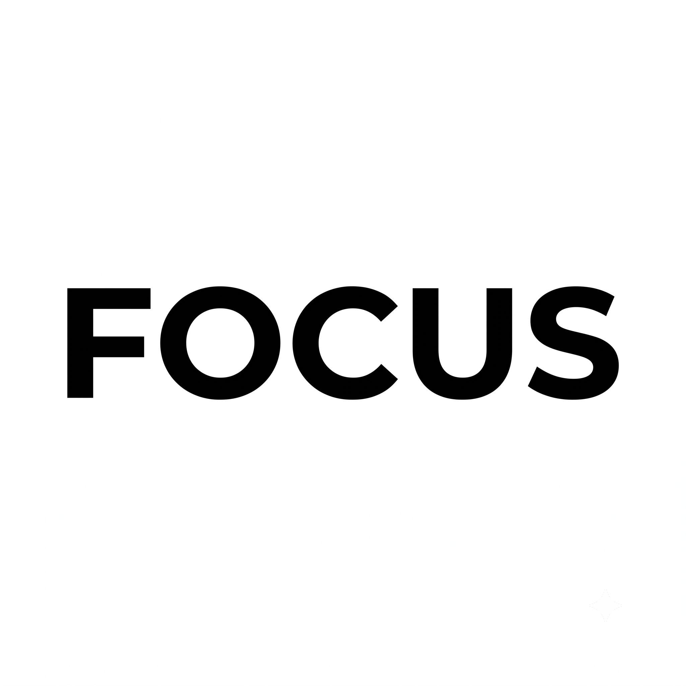

<p align="center">
  
</p>

<h1 align="center">Focus</h1>

<p align="center">
  <strong>A clean, distraction-free Pomodoro timer & daily task companion for Android.</strong>
  <br />
  <em>Crafted with 100% Kotlin & Jetpack Compose. Zero ads. Zero tracking. 100% Offline.</em>
</p>

<p align="center">
  <a href="https://github.com/MuhamadYazri/Focus/releases"></a>
  <a href="https://kotlinlang.org"></a>
  <a href="https://developer.android.com/jetpack/compose"></a>
  <a href="https://developer.android.com/about/dashboards"></a>
  <a href="LICENSE"></a>
</p>

---

## 📖 Why I Built Focus (The Origin Story)

Picture this: You just pushed through an intense 25-minute deep work session. You reach over to pause your timer, take a breath, and relax—only to be blasted by an unskippable 30-second mobile ad with blaring audio. 

Even worse, you open the settings menu to adjust your break interval or check your streak, only to hit a "PRO Upgrade" paywall for basic features that should have been standard.

I was fed up. Most focus apps had become bloated, stingy (*pelit*), and ironically full of the exact clutter and noise they promised to eliminate. I didn't want another subscription trap or gamified social network. I just wanted to **lock in**.

So I built **Focus**—an honest, distraction-free productivity app I actually enjoy using every single day.

---

## 🎨 The Design Philosophy

### 1. Zero Visual Noise: The High-Contrast Look
Too many bright colors, neon badges, and bouncing animations fight for your attention when you're trying to work. Focus uses a clean **black-and-white look** inspired by printed ink on paper—sharp readable numbers, high-contrast layouts, and clean dividers. No visual clutter, no sensory overload. Just pure focus.

### 2. Simple, But Not Boring: A Playful Companion
Ultra-minimal apps can sometimes feel cold, empty, or robotic. To keep the app friendly and alive without adding clutter, a subtle animated companion—a little black cat named *Le Petit Chat Noir*—peeks playfully from the bottom of your screen. It adds a touch of warmth and personality to your desk without pulling your eyes away from your work.

### 3. Calming Background Sounds Instead of Music
Listening to songs with lyrics or changing melodies can break your train of thought. Instead, Focus includes 5 natural background sounds (rain, ocean waves, quiet café, deep forest, and a ticking clock) that loop seamlessly without any sudden pauses or clicks. It creates a steady background that blocks out noisy surroundings and helps you get in the zone.

### 4. Zero Friction: Just "Lock In"
No account creation. No email verification. No onboarding tutorials. No ads. No background trackers. When it's time to work, you tap the clock, put your phone down, and **lock in**.

---

## ⚡ Key Highlights

### ⏱ Big, Bold Poster Clock
- **Easy to read at a glance**: Extra-large, bold numbers that you can easily see from across your desk or room.
- **Clean poster-style layout**: Clean dividing lines and clear digits give it the look of a classic physical desk clock.
- **One-tap Fullscreen Mode**: Tap anywhere on the clock to expand it into an immersive, distraction-free full-screen display.

### 🌿 Seamless Background Sounds
- **No annoying audio gaps**: Uses a smart audio engine that blends sound loops smoothly together, eliminating the sudden clicks, pauses, or pops common in other timer apps.
- **5 calming soundscapes**: Relax to *Rain, Ocean Waves, Cozy Café, Deep Forest, or a Classic Mechanical Clock*.

### 🛡 Distraction Shield (Strict Mode)
- **One-tap focus guard**: Turn on with a single switch before starting a session.
- **Blocks interruptions**: Automatically hides your phone's status bar and silences incoming notifications with **Android Do Not Disturb (DND)** so nothing interrupts your concentration.

### 🏝 Live Lockscreen & Status Bar Controls
- **Keeps ticking in the background**: Your timer stays accurate and visible in your notification shade even if you close the app or turn off your screen.
- **Dynamic Status Bar Pill (Origin Island / Android 16+)**: Displays your remaining time directly in your phone's top status bar with quick buttons to pause, skip, or restart.

### 📋 Daily Tasks & Habits
- **Organize your day**: Group your to-dos with custom categories, set priorities, and track how many Pomodoro sessions each task takes.
- **Fresh start every day**: Completed tasks automatically reset at midnight so you can begin every morning with a clean slate.

### 📊 Simple Charts & Streak Heatmaps
- **Weekly progress bar**: A glanceable bar chart showing your focus hours and completed sessions over the last 7 days.
- **Yearly activity map**: See your entire year's productivity streaks in a clean, GitHub-style activity grid that is easy on the eyes.

---

## 📥 Quick Download (For Everyone)

You do **not** need to be a programmer to use Focus!

1. Go to the [**Latest Releases**](https://github.com/MuhamadYazri/Focus/releases) page.
2. Download **`app-release.apk`** directly to your Android device.
3. Tap the file in your downloads to install it *(enable "Install from this source" if prompted by your browser)*.
4. Open **Focus** and enter your flow state!

---

## 🛠 Tech Stack & Architecture (For Engineers & Recruiters)

Built following modern Android application architecture recommendations, ensuring high testability, memory efficiency, and rapid rendering performance.

| Layer | Technologies Used | Architectural Role |
| :--- | :--- | :--- |
| **Language** | Kotlin 2.0.21 (JVM 17 Target) | Coroutines, Flow, Strict Null Safety, Lambdas |
| **UI Toolkit** | Jetpack Compose (BOM 2024.10.01) | Declarative UI, Shared Bounds Transitions, GraphicsLayers |
| **Design System** | High-Contrast Monochrome ("Paper & Ink") | High-contrast black & white themes, hardware-accelerated fluid UI |
| **State Management**| MVVM + Kotlin `StateFlow` | Unidirectional Data Flow, `collectAsStateWithLifecycle` |
| **Persistence** | Room SQLite v3 + DataStore Preferences | Sub-millisecond aggregation queries, composite indexing |
| **Audio Pipeline** | Dual-Stream `MediaPlayer` Ping-Pong | Sinusoidal overlapping crossfade, zero CPU buffer underruns |
| **System Services** | Foreground Service + MediaSession | Dynamic live notifications, Android 16+ Origin Island |
| **Optimization** | R8 Shrinking + AndroidX Baseline Profiles | Ahead-of-Time (AOT) DEX compilation, dead-code stripping |

<details>
<summary><strong>🔍 Click to view Performance Benchmarks & Code Shrinking Impact</strong></summary>

<br />

| Metric | Before Optimization | After R8 & Baseline Profiles | Improvement |
| :--- | :--- | :--- | :--- |
| **APK File Size** | 21.33 MB | **2.14 MB** | **-89.98%** |
| **Cold Start Latency** | 1260.8 ms | **352.6 ms** | **-72.03%** |
| **99th Percentile Frame Latency** | 61.0 ms | **28.0 ms** | **-54.10%** (Locked 120 FPS) |
| **Tab Switching Delay** | ~48 ms | **< 16 ms** (1 frame) | Pre-warmed GPU layer cache |

</details>

---

## 💻 Developer Setup & Local Build

### Prerequisites
- **Android Studio:** Ladybug (2024.2+) or newer
- **Java Development Kit (JDK):** Version 17+
- **Android SDK:** Platform API 36 (compileSdk: 36, minSdk: 26, targetSdk: 35)

### Build Commands

```bash
# 1. Clone the repository
git clone git@github.com:MuhamadYazri/Focus.git
cd Focus

# 2. Assemble Debug APK
./gradlew assembleDebug

# 3. Assemble Optimized Release APK (R8 minified)
./gradlew assembleRelease

# 4. Install directly to connected physical device or emulator
./gradlew installDebug
```

<details>
<summary><strong>📁 Click to view Repository File Tree</strong></summary>

```
Focus/
├── app/                              # Primary Android Application Module
│   ├── src/main/java/com/yazri/focus/
│   │   ├── data/
│   │   │   ├── local/               # Room Database, DAOs, Entities
│   │   │   ├── preferences/         # Jetpack DataStore preferences
│   │   │   └── repository/          # Repository data orchestrator
│   │   ├── service/                 # TimerEngine, ForegroundService, SoundEngine, Haptics
│   │   ├── ui/
│   │   │   ├── tasks/               # Task management & SwipeActionRow
│   │   │   ├── timer/               # 2-Tier Clash Display Clock & Fullscreen mode
│   │   │   ├── analytics/           # Capsule charts & Activity heatmaps
│   │   │   ├── profile/             # Preferences, categories & audio credits dialog
│   │   │   ├── navigation/          # 1:1 PagerSwipeController & macOS tactile dock
│   │   │   └── theme/               # Color palette, depth styling, custom typography & shapes
│   │   ├── FocusApp.kt              # Application-scoped dependency container
│   │   └── MainActivity.kt          # Single Activity root container
│   ├── src/main/res/                # Vectors, custom typography & raw audio loops
│   ├── build.gradle                 # Application build rules & R8 optimization
│   └── proguard-rules.pro           # ProGuard / R8 keep rules
├── baselineprofile/                  # AndroidX Baseline Profile generator module
├── gradle/                          # Gradle wrapper files
├── build.gradle                     # Top-level project Gradle configuration
├── settings.gradle                  # Subproject declarations (:app, :baselineprofile)
├── gradle.properties                # Build environment performance properties
└── README.md                        # Documentation
```

</details>

---

## 🎨 Credits & Attributions

We believe in honoring and supporting independent creators who make open-source software and open media possible:

### 🔊 Ambient Soundscapes
Recorded and published by **Joseph SARDIN** on [BigSoundBank.com](https://bigsoundbank.com) under the **Creative Commons 0 (CC0 / Public Domain)** license:
- ⏱ **Clock**: [Stopwatch 2 (ID 2138)](https://bigsoundbank.com/stopwatch-2-s2138.html)
- ☕ **Café**: [Atmosphere bar 2 (ID 0481)](https://bigsoundbank.com/atmosphere-bar-2-s0481.html)
- 🌊 **Waves**: [Sea waves and seagulls (ID 0267)](https://bigsoundbank.com/sea-waves-and-seagulls-s0267.html)
- 🌧 **Rain**: [Rain and storm (ID 0124)](https://bigsoundbank.com/rain-and-storm-s0124.html)
- 🌲 **Forest**: [Forest (ID 0100)](https://bigsoundbank.com/forest-s0100.html)

*The harmonic completion chime is synthesized directly in code via pure mathematical sine wave harmonics.*

### 🐱 Mascot Peek Animation
- **Cat Mascot ("Le Petit Chat Noir")**: Motion design by **Tom Fabre** on [LottieFiles](https://lottiefiles.com) (Lottie Simple License). Used for the playful edge-peeking focus companion.

---

## 🤝 Contributing

Contributions, feature suggestions, and feedback are always welcome!

1. Fork the Project.
2. Create your Feature Branch (`git checkout -b feat/amazing-feature`).
3. Commit your Changes (`git commit -m "feat: add amazing feature"`).
4. Push to the Branch (`git push origin feat/amazing-feature`).
5. Open a Pull Request.

---

## 📄 License

Distributed under the **MIT License**. See [`LICENSE`](LICENSE) for more information.

<p align="center">
  Crafted with care by <strong><a href="https://github.com/MuhamadYazri">Muhamad Yazri</a></strong>
</p>
