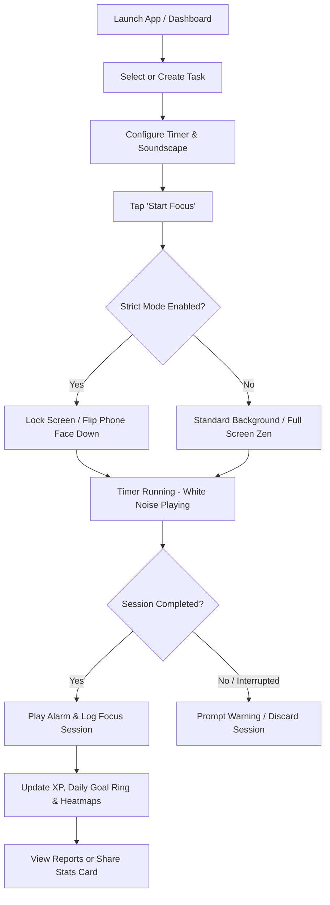

# Product Requirements Document (PRD): Focus — Study & Productivity Time Tracker

**Document Status:** Draft / V1.0  
**Product Name:** Focus (Study & Time Tracker)  
**Target Platforms:** iOS, Android, Desktop (macOS/Windows/Linux), Web  
**Primary Objective:** Deliver a unified task management, Pomodoro time tracking, and deep personal analytics application designed to help students, professionals, and lifelong learners achieve flow state and maximize productivity.

---

## 1. Executive Summary & Vision

**Focus** combines the structured workflow of modern task management (To-Do lists, projects, tags, and reminders) with the scientifically proven **Pomodoro Technique** and Zen-like immersion tools (white noise, strict phone lock modes, and dynamic themes). 

Unlike basic timer apps or plain todo lists, Focus provides **granular productivity analytics**—tracking daily focus goals, active focus hours across 24-hour heatmaps, project time distributions, and gamified global leaderboards. Users can visualize their long-term progress, share aesthetic achievement report cards on social media, and seamlessly sync their study sessions across all devices.

---

## 2. Key Objectives & Success Metrics (KPIs)

| Metric Category | Target KPI | Measurement Methodology |
| :--- | :--- | :--- |
| **User Engagement** | **Daily Active Users (DAU) / MAU >= 40%** | Users initiating at least one Pomodoro session or completing 1 task per day. |
| **Session Quality** | **Average Daily Focus Time >= 2.5 Hours** | Aggregate recorded focus time per active user across all projects. |
| **Goal Attainment** | **Daily Goal Completion Rate >= 60%** | Percentage of active users meeting their customized daily focus target (e.g., 4h). |
| **Retention** | **30-Day Retention >= 35%** | Cohort tracking of users returning to log study sessions after month 1. |
| **Monetization** | **Free-to-Premium Conversion >= 5%** | Conversion rate to 3-Month or Lifetime Premium subscriptions. |

---

## 3. Target Audience & User Personas

1. **The Intensive Student (e.g., University / Medical / Law Student)**
   - **Needs:** Needs to juggle multiple subjects ("English", "Study Pagi", "Nugas"), track exam revision hours, and block distracting social media apps during study sprints.
   - **Value:** Visualizing study streaks, custom Pomodoro lengths per subject, and ambient background sounds.
2. **The Remote Professional / Developer ("Ngodingg")**
   - **Needs:** Manages deep work coding blocks, estimates time per task vs. actual time spent, and requires desktop-mobile synchronization.
   - **Value:** Detailed project time distribution donut charts, task tagging, and historical yearly reporting.
3. **The Lifelong Learner & Self-Improver**
   - **Needs:** Building consistent daily habits ("Healtier lifee", reading), staying motivated through gamification.
   - **Value:** Global user ranking leaderboards, XP level badges, and shareable social media report cards.

---

## 4. Comprehensive Feature Specifications

### Module 1: Task & Project Management (Smart To-Do)
Focus organizes work into actionable, estimated chunks linked directly to timers.

* **Smart Navigation Views:** Automatically filters tasks into **Today**, **Tomorrow**, **This Week**, **Planned** (scheduled), and **Completed** lists.
* **Project Folders & Categorization:** Users can create custom projects (e.g., *English*, *Study*, *Gaming*, *Work*) with unique color coding and folder grouping.
* **Granular Task Metadata:**
  * **Estimated vs. Actual Pomodoros:** Set target focus intervals (e.g., 4 Pomodoros) and track live completion (e.g., `19.9 / 1` completed).
  * **Due Dates & Scheduling:** Assign date/time deadlines integrated with a calendar view.
  * **Reminders & Alerts:** Push notifications for scheduled study start times.
  * **Repeating Tasks:** Daily, weekly, or custom recurring intervals for routine study habits.
  * **Task Tags & Labels:** Cross-project filtering using customizable tags.
* **Dashboard Summary Header:** Live display of **Estimated Time remaining**, **Incomplete Tasks count**, **Total Time Spent**, and **Completed Tasks**.

---

### Module 2: The Focus Engine & Zen Timer System
The core execution environment designed to eliminate cognitive friction and external distractions.

* **Dual Timer Modes:**
  * **Pomodoro Mode:** Standard 25-min focus / 5-min break (fully customizable per task in Premium).
  * **Stopwatch Mode:** Open-ended count-up timer for uninterrupted flow sessions.
* **Immersive Zen Environment:**
  * **Dynamic Background Themes:** Aesthetic nature scenery and tactile minimalist light zen modes.
  * **White Noise & Soundscapes:** Integrated audio player featuring rain, forest wind, ocean waves, cafe chatter, and ticking clocks to boost concentration.
  * **Full-Screen Mode:** Distraction-free full-screen UI hiding system status bars and notifications.
* **Strict Mode (Digital Wellbeing & Distraction Blocking):**
  * **App & Notification Blocking:** Prevents opening distracting apps (Instagram, TikTok, WhatsApp) during active sessions.
  * **Phone Lock / Flip-to-Focus:** Requires the user to place their phone face-down; lifting the phone pauses or cancels the timer with a warning.

---

### Module 3: Deep Analytics, Statistics & Reporting
Focus provides enterprise-grade personal BI (Business Intelligence) for student productivity.

* **Multi-Period Aggregations:** Switch seamlessly between **Daily**, **Weekly**, **Monthly**, **Yearly**, and **Total** historical views.
* **Core Metrics Tracked:**
  * **Total Focus Time (hours/minutes)** with period-over-period percentage changes (e.g., *Up 3h 21m from last week*).
  * **Total Pomodoros Completed** & **Total Tasks Completed**.
  * **Average Daily Focus Time** & **Total Days Focused streak count**.
* **Advanced Visualizations:**
  * **Pomodoro Records Heatmap:** GitHub-style chronological grid showing activity intensity across days and hours.
  * **24-Hour Focus Periods Timeline:** Day/Night bar chart (`00:00` to `24:00` with sun/moon markers) mapping exact hours when the user is most productive.
  * **Project Time Distribution:** Donut charts and percentage breakdowns showing time allocation across different subjects or projects.
  * **Daily Focus Goal Calendar Matrix:** A monthly calendar grid indicating goal achievement rings (e.g., 63% completed towards a 4-hour daily target).

---

### Module 4: Gamification, Leaderboards & Social Sharing
Motivates users by turning solo studying into a rewarding, community-driven experience.

* **Experience Points (XP) & Level Badges:** Users gain XP for every completed Pomodoro and task, unlocking crown/trophy level badges displayed on their profile.
* **Global & Community Leaderboards:** Real-time user ranking (e.g., *Rank No. 51,238 — ikhwanyazri3 with 783.8h*). Users can compete globally or within study groups/friends.
* **Aesthetic Shareable Report Cards:**
  * Generates high-resolution social media stories/posts (Instagram, X, Discord).
  * Customizable background photography, motivational quotes (*"I'm using Focus To-Do to stay focused on work and study"*), and key lifetime stats (*Total Hours, Pomodoros, Days Focused*).
  * One-click **Save to Gallery** or **Share** native OS integration.

---

### Module 5: Cloud Sync & Premium Monetization (Freemium Model)
A sustainable business model offering powerful cloud backup and advanced customizations.

| Feature | Free Tier | Premium Tier |
| :--- | :---: | :---: |
| **Active Projects & Tasks** | Up to 3 Projects / Limited Tasks | **Unlimited Projects & Tasks** |
| **Pomodoro Lengths** | Fixed 25m / 5m breaks | **Custom Timer Lengths per Task** |
| **Cloud Backup & Device Sync** | Local Storage Only | **Real-Time Multi-Device Cloud Sync** |
| **Advanced Statistics** | Basic Daily / Weekly view | **Full Monthly/Yearly/Heatmaps & Export** |
| **Strict Mode & App Blocking** | Basic Timer Lock | **Full App Block, Notification Mute, Flip Phone** |
| **Soundscapes & Themes** | 2 Basic Sounds & Standard Light Theme | **All White Noise Audio & Premium Themes** |
| **Manual Data Entry** | Disabled | **Manually Add & Edit Pomodoro Records** |

* **Pricing Structure (Localized Example IDR / USD equivalent):**
  * **3-Month Subscription:** `Rp 69.000` (~$4.50 USD / quarter).
  * **Lifetime Purchase:** `Rp 199.000` (~$12.99 USD one-time payment, discounted at 50% off).
* **Customer Support & Recovery:** Built-in purchase fail-safe with direct support contact (`support@focustodo.net`).

---

## 5. Technical Architecture & Data Models

### 5.1 Proposed Technology Stack
* **Frontend Mobile / Desktop:** Flutter (Dart) or React Native for high-performance cross-platform UI with native bridge access (for screen lock, app blocking, and background audio).
* **Backend API & Sync Engine:** Node.js (TypeScript) with NestJS or Laravel (PHP) REST/GraphQL API.
* **Database:**
  * **Local Persistence:** SQLite / WatermelonDB (offline-first architecture).
  * **Cloud Database:** PostgreSQL (for relational data, users, subscriptions) + Redis (for real-time global leaderboard ranking calculations).
* **Audio Engine:** Native background audio services (iOS AVFoundation / Android ExoPlayer) ensuring white noise plays seamlessly when the screen is locked.

### 5.2 Core Entity-Relationship Schema (JSON Representation)

```json
{
  "User": {
    "id": "uuid",
    "username": "string",
    "email": "string",
    "avatar_url": "string",
    "level": "integer",
    "xp": "integer",
    "global_rank": "integer",
    "daily_focus_goal_minutes": 240,
    "is_premium": "boolean",
    "premium_expiry": "timestamp"
  },
  "Project": {
    "id": "uuid",
    "user_id": "uuid",
    "title": "string",
    "color_hex": "#FF5252",
    "icon_name": "folder",
    "is_archived": "boolean",
    "created_at": "timestamp"
  },
  "Task": {
    "id": "uuid",
    "project_id": "uuid",
    "title": "string",
    "estimated_pomodoros": 4,
    "completed_pomodoros": 2,
    "total_time_spent_seconds": 3000,
    "due_date": "timestamp",
    "reminders": ["timestamp"],
    "tags": ["string"],
    "is_completed": "boolean",
    "repeat_rule": "string (cron / rrule)"
  },
  "PomodoroSession": {
    "id": "uuid",
    "task_id": "uuid",
    "user_id": "uuid",
    "start_time": "timestamp",
    "end_time": "timestamp",
    "duration_seconds": 1500,
    "mode": "pomodoro | stopwatch",
    "strict_mode_enabled": "boolean",
    "was_completed": "boolean",
    "hour_of_day": 14
  }
}
```

---

## 6. User Experience (UX) & Flow Architecture



---

## 7. Development Roadmap & Phased Rollout

### Phase 1: MVP Core (Weeks 1–4)
* [x] Project setup, unified Light Mode design system tokens (#E2E4DC, #F9F9F6, #1A1F18, #ED7D31, #40513B).
* [ ] Local SQLite database schema for Projects, Tasks, and Sessions.
* [ ] Core Task Management UI (Add, Complete, Estimate Pomodoros, Smart Lists).
* [ ] Standard 25/5 Pomodoro Timer with start/pause/reset and sound notification.
* [ ] Basic Daily & Weekly Focus Time bar charts.

### Phase 2: Advanced Focus & Zen Features (Weeks 5–8)
* [ ] Integrated audio player with loopable White Noise soundscapes (Rain, Forest, Cafe).
* [ ] Timer Mode toggle (Pomodoro vs. Stopwatch count-up).
* [ ] Strict Mode implementation (Screen lock wake lock, flip-device accelerometer detection).
* [ ] Advanced Statistics: 24-hour focus period timelines, project distribution donut charts, and monthly goal calendar matrices.

### Phase 3: Cloud Sync, Gamification & Premium (Weeks 9–12)
* [ ] User authentication (OAuth / Email) and real-time cloud database synchronization.
* [ ] XP ranking system, badges, and global Redis leaderboard integration.
* [ ] Social media shareable image generator (canvas/image rendering with stats).
* [ ] In-App Purchases (IAP) integration for 3-Month and Lifetime Premium tiers.

---

## 8. Open Questions & User Review Required

1. **Target Platform Priority:** Should we develop the mobile app first (iOS/Android via Flutter/React Native) or start with a Web/Desktop version?
2. **Strict Mode App Blocking:** Full app blocking on iOS requires Screen Time API / Family Controls entitlements from Apple. Should we prioritize "Flip-to-Focus" (accelerometer-based) first to ensure faster app store approval?
3. **Payment Gateway:** For localized pricing (`Rp 69.000` / IDR), do you want to integrate Midtrans / Xendit alongside standard Apple App Store / Google Play billing?
4. **White Noise Assets:** Should ambient sounds be bundled locally within the app (increases app binary size by ~20MB) or streamed/downloaded on demand from cloud storage?

---
*End of PRD — Generated for Project Focus*
